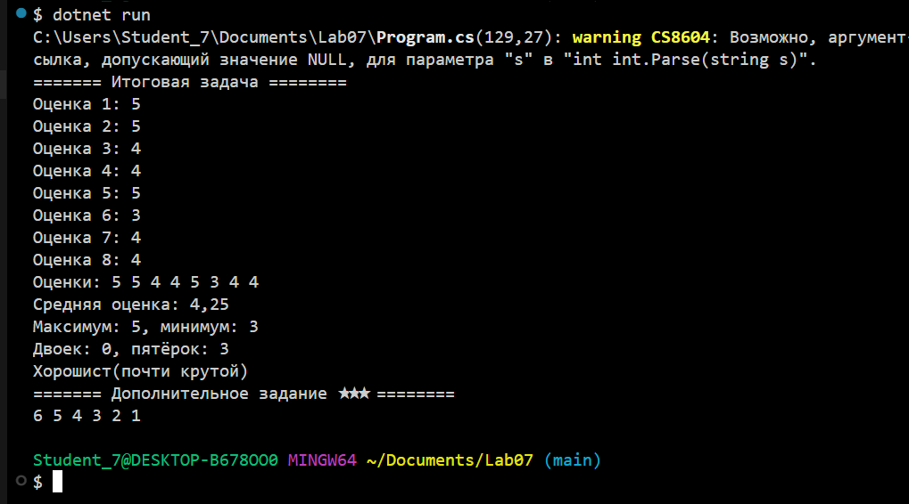
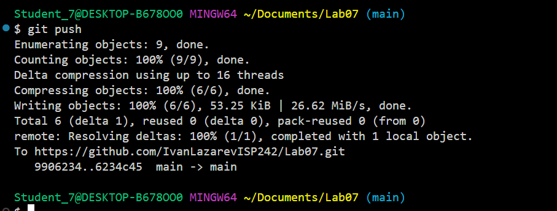

# Практическая работа №7

**ФИО:** Игошин Кирилл, Лазарев Иван
**Группа:** ИСП-242
**Дата:** 14.10.2026

## Что изучено

* Индекс массива начинается с нуля, последний элемент имеет индекс `Length - 1`.
* `foreach` нужен, когда важны только значения элементов; если нужно изменить элемент или узнать его индекс — используем `for`.
* Через `foreach` элементы можно только читать, изменять их нельзя — для изменения обязателен доступ по индексу через `for`.

## Скриншоты

